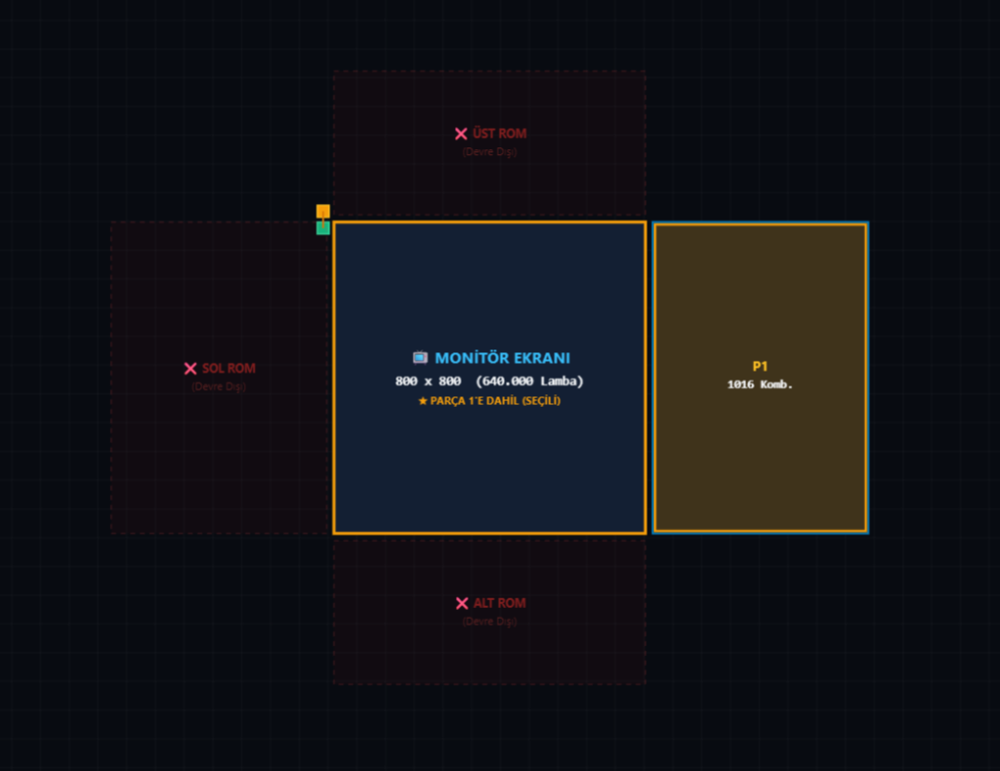

# Factorio 2.0 Video-to-Blueprint Generator ⚡

[](https://factorio.com/)
[](https://github.com/)
[](https://www.python.org/)
[](https://dotnet.microsoft.com/)
[](LICENSE)

[**English**](#-english) | [**Türkçe**](#-türkçe)

---

# 🇬🇧 English

Converts video files (`.mp4`, `.webm`, `.avi`, `.mov`) and `.gif` animations into functional in-game video player blueprints for **Factorio 2.0 (Space Age)**. Each blueprint contains a display screen of small lamps, a ROM circuit bank holding encoded video data, centralized decoders, a master clock, and a power distribution grid.



---

## 1. Choosing a Circuit Engine

The generator provides three distinct circuit engines. Each engine is built for a specific balance of color accuracy, video length, and blueprint size:

| Engine | Color Mode | Frames per Signal | ROM Combinators | Best Suited For |
| :--- | :---: | :---: | :--- | :--- |
| **Engine V1 (TrueColor)** | **24-bit TrueColor** (16.7M colors) | 1 Frame | 1 CC + 1 Decider / frame | Pristine color fidelity, short clips, pixel art |
| **Engine V2 (Compact Color)** | **9-bit RGB** (512 colors) | 3 Frames | **1 CC + 6 Combinators / 3 frames** (7 entities) | Colored animations with reduced footprint |
| **Engine V3 (High-Capacity)** | **2-bit Grayscale** (4 levels) | 16 Frames | 1 CC + 1 Decider / 16 frames | Long videos, massive screens (48p, 64p, 100p+) |

> **All three engines** utilize all 6 Space Age quality tiers (`normal`, `uncommon`, `rare`, `epic`, `legendary`, `quality-unknown`) across 2,168 safe signals, achieving up to **13,008 pixels per single green bus stripe**.
> Detailed signal math and decoder schematics are documented in [`docs/CIRCUIT_ARCHITECTURE_OVERVIEW.md`](docs/CIRCUIT_ARCHITECTURE_OVERVIEW.md).

---

## 2. Configuration Settings Guide

### 2.1. Monitor Resolution & Aspect Ratio
* **Height**: Sets the number of lamp rows on the monitor (e.g. 16, 32, 48, 64).
* **Width**: Automatically computed from the source media aspect ratio ($W = \text{round}(H \times \frac{W_{orig}}{H_{orig}})$) so the image is never stretched or distorted. Total lamps = $W \times H$.

### 2.2. ROM Circuit Placement & Layout
* **Direction**:
  * `Horizontal`: Builds the ROM to the Left, Right, or Dual (both sides) of the monitor.
  * `Vertical`: Builds the ROM on Top, Bottom, or Dual (both sides) of the monitor.
* **Compact ROM (Recommended)**: Eliminates dead tile padding between combinator rows. When combinators encounter 2x2 substations, the layout algorithm automatically steps past the substation footprint without skipping lines or breaking the 9.0-tile wire reach.
* **Fill All Rows (Recommended)**: Folds ROM combinators into a 2D matrix along the monitor's dimensions instead of extending into a single long strip across the map.

### 2.3. Substation Quality & Power Grid
* **Quality Selector**: Selects substation tier (`normal`, `uncommon`, `rare`, `epic`, `legendary`), scaling supply reach from $18\times 18$ up to $28\times 28$. Copper power connections are wired automatically.
* **No Substation (`none`)**: Excludes all power poles for sandbox maps or floor-powered grids.

### 2.4. Framerate (FPS) & Frame Count
* **FPS**: Sets the playback speed (1 to 60). The master selector clock uses Factorio's native 60 ticks/s rate (`TicksPerFrame = 60 / FPS`).
* **Frame Limits**: Process the entire video or set a maximum frame limit.

### 2.5. Modular ROM Slicing
* **Part Slicing (1 to 16 Parts)**: Divides large blueprints into modular slices for easy construction robot placement.
* **Alignment Anchor**: Every sliced part includes an anchor substation placed at `(-1, -1)`. Pasting parts sequentially in-game snaps them together with zero tile drift.

---

## 3. How to Run

### Windows (Desktop GUI)
Double-click `FactorioVideoToBlueprint.exe` or execute:
```bat
run.bat
```
*(Requires .NET 8.0 WPF and Python 3.10+).*

### Linux & macOS (Web GUI)
Run the launcher script to open the application in your browser:
```bash
chmod +x run.sh
./run.sh
```
Or run the Python server directly:
```bash
python server.py --port 5000
```

### Command Line Interface (CLI)
Compile blueprints directly from any terminal:
```bash
# Generate built-in demo animation
python video_to_blueprint.py

# Compile custom video with Engine V1 (TrueColor)
python video_to_blueprint.py clip.mp4 -H 32 --fps 5 --engine v1 -o blueprint_v1.txt

# Compile custom video with Engine V3 (2-bit High Capacity)
python video_to_blueprint.py movie.mp4 -H 48 --fps 5 --engine v3 -o blueprint_v3.txt
```

---

## 4. Repository Structure

```text
factorio-video-to-blueprint/
├── docs/                             # Technical architecture & engineering specifications
│   ├── CIRCUIT_ARCHITECTURE_OVERVIEW.md  # End-to-end pipeline, math & engine comparison
│   ├── CIRCUIT_ENGINE_V3_ARCHITECTURE.md # V3 2-bit temporal packing deep dive
│   ├── CIRCUIT_ENGINE_V1_V2_ARCHITECTURE.md # V1 TrueColor & V2 Compact Color deep dive
│   ├── COMPACT_ROM_ARCHITECTURE.md       # Zero-gap layout & substation collision math
│   ├── LAMP_AND_DISPLAY_ARCHITECTURE.md  # Factorio 2.0 lamp RGB mode & signal bus
│   ├── POWER_DISTRIBUTION_AND_SUBSTATIONS.md # Substation coverage math & power grid
│   └── all-signals.txt                   # Complete 13,344 Space Age signal dictionary
├── examples/                         # Ready-to-use sample blueprint text exports
│   ├── blueprint.txt
│   ├── blueprint_legendary.txt
│   └── blueprint_legendary_24p.txt
├── tools/                            # Utility scripts and dataset references
│   ├── blueprint_decode.py
│   ├── valid_base_items.json
│   └── valid_base_signals.json
├── core/                             # Video processor & circuit compilation engines (V1, V2, V3)
├── FactorioVideoToBlueprint/         # Windows WPF application & Web UI frontend (wwwroot)
├── server.py                         # Cross-platform Web server (Linux, macOS, Windows)
├── run.sh                            # Linux & macOS one-click launcher
├── run.bat                           # Windows one-click launcher
├── main.py                           # Unified Python entry point
├── video_to_blueprint.py             # Main CLI compilation tool
├── bridge.py                         # IPC backend bridge
└── safe_signals_pool.json            # 2,168 safe signal definitions
```

---

## 5. Technical Documentation

Detailed engineering specifications are available in [`docs/`](docs/):
* [Circuit Architecture & Pipeline Guide](docs/CIRCUIT_ARCHITECTURE_OVERVIEW.md) — Comprehensive pipeline math, signal packing, and layout mechanics.
* [Circuit Engine V3 Architecture](docs/CIRCUIT_ENGINE_V3_ARCHITECTURE.md) — 2-bit temporal packing, 6 qualities, and single-combinator TrueColor adapter.
* [Color Circuit Engines (V1 & V2)](docs/CIRCUIT_ENGINE_V1_V2_ARCHITECTURE.md) — 24-bit TrueColor and 9-bit compact color specifications.
* [Compact ROM Architecture](docs/COMPACT_ROM_ARCHITECTURE.md) — Interval collision algorithms and zero-gap placement.
* [Lamp & Display Architecture](docs/LAMP_AND_DISPLAY_ARCHITECTURE.md) — Factorio 2.0 `small-lamp` color mode 2 and trunk bus routing.
* [Power Distribution & Substations](docs/POWER_DISTRIBUTION_AND_SUBSTATIONS.md) — Substation quality coverage and copper wiring logic.
* [Space Age All-Signals Reference](docs/all-signals.txt) — 13,344 indexed Space Age signals blueprint reference.

---

## 🛠️ License

This project is licensed under the [MIT License](LICENSE).

---
---

# 🇹🇷 Türkçe

Video dosyalarını (`.mp4`, `.webm`, `.avi`, `.mov`) ve `.gif` animasyonlarını **Factorio 2.0 (Space Age)** oyununda çalışan video oynatıcı blueprint'lerine dönüştürür. Üretilen blueprint; küçük lambalardan oluşan bir ekran, kodlanmış video verilerini saklayan bir ROM devre bankası, şerit başı merkezi dekoderler, saat devresi ve elektrik dağıtım ağını içerir.


---

## 1. Devre Motoru Seçimi

Uygulama, farklı kullanım ihtiyaçlarına göre tasarlanmış 3 bağımsız devre motoru sunar:

| Motor | Renk Modu | Sinyal Başına Kare | ROM Kombinatör Sayısı | İdeal Kullanım Alanı |
| :--- | :---: | :---: | :--- | :--- |
| **Motor V1 (TrueColor)** | **24-bit TrueColor** (16.7M renk) | 1 Kare | 1 CC + 1 Decider / kare | Kusursuz renk doğruluğu, kısa klipler, piksel sanatı |
| **Motor V2 (Kompakt Renkli)** | **9-bit RGB** (512 renk) | 3 Kare | **1 CC + 6 Kombinatör / 3 kare** (7 varlık) | Renkli animasyonlar, orta boy videolar |
| **Motor V3 (Yüksek Kapasiteli)**| **2-bit Gri Tonlama** (4 seviye) | 16 Kare | 1 CC + 1 Decider / 16 kare | Uzun videolar, devasa ekranlar (48p, 64p, 100p+) |

> **Her üç motor da** 2.168 güvenli temel sinyal üzerinde Space Age'in 6 kalite seviyesini (`normal`, `uncommon`, `rare`, `epic`, `legendary`, `quality-unknown`) kullanarak tek bir yeşil kablo şeridinde **13.008 piksele** kadar kapasite sunar.
> Detaylı sinyal matematiği ve dekoder şemaları [`docs/CIRCUIT_ARCHITECTURE_OVERVIEW.md`](docs/CIRCUIT_ARCHITECTURE_OVERVIEW.md) belgesindedir.

---

## 2. Ayarlar Kılavuzu

### 2.1. Monitör Çözünürlüğü ve En/Boy Oranı
* **Yükseklik**: Monitörün lamba satır sayısını belirler (örn. 16, 32, 48, 64).
* **Genişlik**: Videonun orijinal en/boy oranından otomatik hesaplanır ($W = \text{round}(H \times \frac{W_{orig}}{H_{orig}})$); görüntü asla basıklaşmaz veya esnemez. Toplam lamba sayısı $W \times H$ olur.

### 2.2. ROM Devresi Konumu ve Yerleşim
* **Yön (Direction)**:
  * `Yatay`: ROM monitörün Sağına, Soluna veya Çift (her iki yanına) kurulur.
  * `Dikey`: ROM monitörün Üstüne, Altına veya Çift (her iki tarafına) kurulur.
* **Kompakt ROM (Önerilen)**: Kombinatör sıraları arasındaki boşlukları sıfırlar. Kombinatörler 2x2 trafolara denk geldiğinde yerleşim algoritması trafo alanını otomatik atlar; satır boşluğu bırakmaz ve kablo mesafelerini 9.0 karo altında tutar.
* **Tüm Satırları Doldur (Önerilen)**: ROM kombinatörlerini haritada tek bir ince hat halinde uzatmak yerine monitörün satır/sütun genişliği boyunca 2B blok halinde yerleştirir.

### 2.3. Trafo Niteliği ve Elektrik Şebekesi
* **Nitelik Seçimi**: Trafo kalitesine (`normal`, `uncommon`, `rare`, `epic`, `legendary`) göre elektrik kapsama alanı $18\times 18$'den $28\times 28$'e kadar genişler. Bakır elektrik kabloları otomatik örülür.
* **Trafosuz Mod (`none`)**: Yaratıcı haritalar ve zemin elektriği modları için trafoları devre dışı bırakır.

### 2.4. FPS ve Kare Kontrolü
* **FPS**: Oynatma hızını belirler (1–60). Merkezi saat devresi Factorio'nun saniyede 60 tick çalışma hızına göre sayar (`TicksPerFrame = 60 / FPS`).
* **Kare Sınırı**: Videonun tamamını işleyebilir veya maksimum kare sınırı koyabilirsiniz.

### 2.5. Modüler ROM Parçalama (Slicing)
* **Parça Sayısı (1 - 16)**: Büyük devreleri inşaat botlarının kolay basabilmesi için parçalara böler.
* **Hizalama Çapası**: Her parça `(-1, -1)` koordinatında ortak bir çapa trafosu içerir. Oyunda parçalar sırayla basıldığında devreler sıfır kayma ile birbirine oturur.

---

## 3. Çalıştırma Yöntemleri

### Windows (Masaüstü Uygulaması)
`FactorioVideoToBlueprint.exe` dosyasını çalıştırın veya terminalden:
```bat
run.bat
```
*(Gereksinim: .NET 8.0 WPF ve Python 3.10+).*

### Linux ve macOS (Web Arayüzü)
Başlatıcı betiği çalıştırarak tarayıcınızda açabilirsiniz:
```bash
chmod +x run.sh
./run.sh
```
Veya doğrudan Python sunucusunu başlatın:
```bash
python server.py --port 5000
```

### Komut Satırı (CLI)
Doğrudan terminal üzerinden blueprint derlemek için:
```bash
# Dahili demoyu derle
python video_to_blueprint.py

# Motor V1 (TrueColor) ile renkli derleme yap
python video_to_blueprint.py klip.mp4 -H 32 --fps 5 --engine v1 -o blueprint_v1.txt

# Motor V3 (2-bit Yüksek Kapasite) ile derleme yap
python video_to_blueprint.py film.mp4 -H 48 --fps 5 --engine v3 -o blueprint_v3.txt
```

---

## 4. Dizin Yapısı

```text
factorio-video-to-blueprint/
├── docs/                             # Teknik mimari dokümanları ve sinyal referansları
│   ├── CIRCUIT_ARCHITECTURE_OVERVIEW.md  # İşlem hattı, matematik ve motor karşılaştırması
│   ├── CIRCUIT_ENGINE_V3_ARCHITECTURE.md # V3 2-bit zamansal paketleme detay dokümanı
│   ├── CIRCUIT_ENGINE_V1_V2_ARCHITECTURE.md # V1 TrueColor ve V2 Kompakt Renkli mimari dokümanı
│   ├── COMPACT_ROM_ARCHITECTURE.md       # Sıfır boşluklu yerleşim ve trafo çarpışma matematiği
│   ├── LAMP_AND_DISPLAY_ARCHITECTURE.md  # Factorio 2.0 lamba RGB modu ve veri yolu tasarımı
│   ├── POWER_DISTRIBUTION_AND_SUBSTATIONS.md # Trafo menzil matematiği ve güç şebekesi
│   └── all-signals.txt                   # 13.344 sinyallik Space Age referans blueprint dökümü
├── examples/                         # Hazır ve test edilmiş örnek blueprint metinleri (.txt)
│   ├── blueprint.txt
│   ├── blueprint_legendary.txt
│   └── blueprint_legendary_24p.txt
├── tools/                            # Yardımcı betikler ve veri listeleri
│   ├── blueprint_decode.py
│   ├── valid_base_items.json
│   └── valid_base_signals.json
├── core/                             # Video işleme ve devre derleme motorları (V1, V2, V3)
├── FactorioVideoToBlueprint/         # Windows WPF uygulaması ve Web arayüz dosyaları (wwwroot)
├── server.py                         # Çapraz platform Web sunucusu (Linux, macOS, Windows)
├── run.sh                            # Linux ve macOS tek tıkla başlatıcı
├── run.bat                           # Windows tek tıkla başlatıcı
├── main.py                           # Birleşik Python çalıştırma noktası
├── video_to_blueprint.py             # Ana CLI derleme giriş noktası
├── bridge.py                         # Arayüz ile motor arası IPC köprüsü
└── safe_signals_pool.json            # 2.168 adet güvenli temel sinyal veritabanı
```

---

## 5. Teknik Dokümantasyon

Ayrıntılı devre mühendisliği belgeleri [`docs/`](docs/) dizinindedir:
* [Devre Mimarisi ve İşlem Hattı Kılavuzu](docs/CIRCUIT_ARCHITECTURE_OVERVIEW.md) — Uçtan uca işlem hattı, paketleme matematiği ve motor karşılaştırması.
* [Circuit Engine V3 Mimarisi](docs/CIRCUIT_ENGINE_V3_ARCHITECTURE.md) — 2-bit zamansal paketleme, 6 kalite seviyesi ve tek kombinatörlük TrueColor uyarlayıcı.
* [Renkli Devre Motorları (V1 & V2)](docs/CIRCUIT_ENGINE_V1_V2_ARCHITECTURE.md) — 24-bit TrueColor ve 9-bit kompakt renkli devre mimarisi.
* [Kompakt ROM Mimarisi](docs/COMPACT_ROM_ARCHITECTURE.md) — Aralık kesişim algoritmaları ve sıfır boşluklu yerleşim.
* [Lamba ve Monitör Mimarisi](docs/LAMP_AND_DISPLAY_ARCHITECTURE.md) — Factorio 2.0 `small-lamp` color mode 2 ve veri yolu tasarımı.
* [Trafo ve Güç Dağıtım Mimarisi](docs/POWER_DISTRIBUTION_AND_SUBSTATIONS.md) — Trafo nitelik menzilleri ve otomatik bakır kablolama.
* [Space Age Tüm Sinyaller Referansı](docs/all-signals.txt) — 13.344 sinyalin tamamını içeren referans blueprint dökümü.

---

## 🛠️ Lisans

Bu proje [MIT Lisansı](LICENSE) kapsamında sunulmaktadır.
