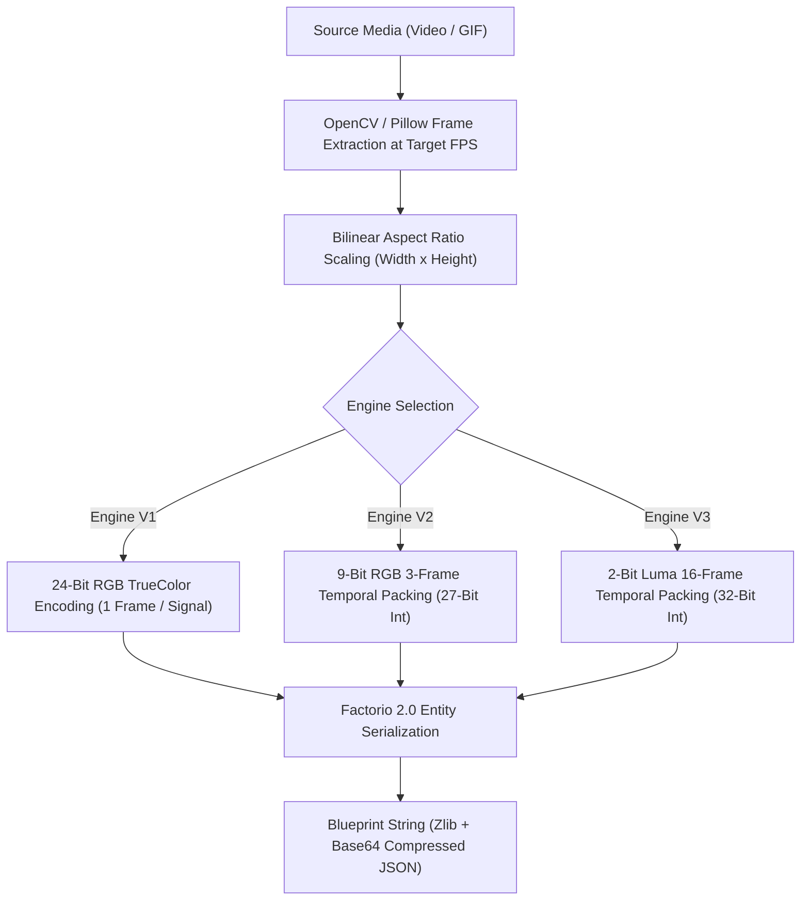
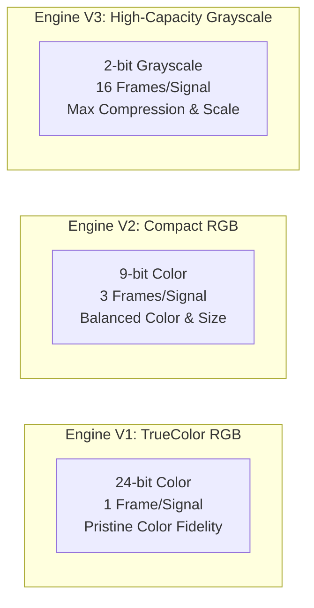
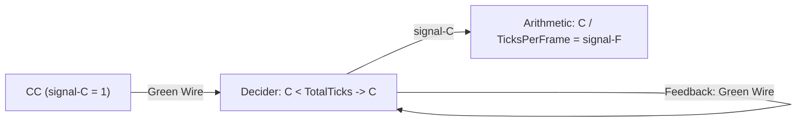
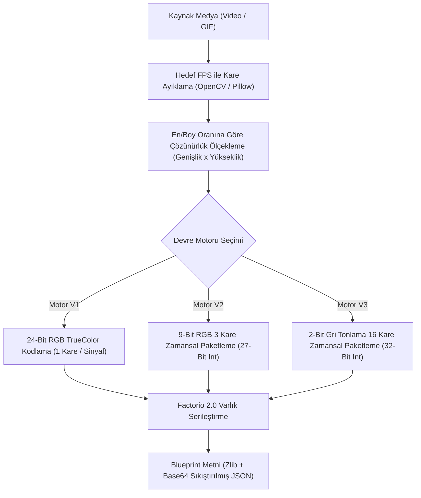
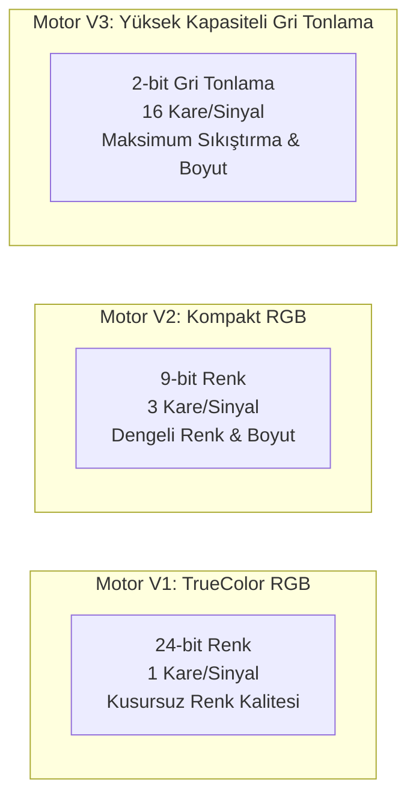
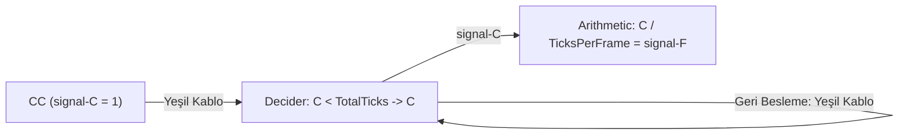

# Circuit Network Architecture & Pipeline Guide ⚡

[**English**](#-english) | [**Türkçe**](#-türkçe)

---

# 🇬🇧 English

This document provides a comprehensive technical breakdown of how media files are processed into Factorio 2.0 (Space Age) circuit networks, comparing all three circuit engines, explaining signal bit-packing math, combinator layout algorithms, and power distribution mechanics.

---

## 1. End-to-End Processing Pipeline

1. **Frame Extraction**: The source video/GIF is decoded into sequential frames at the chosen framerate (`1–60 FPS`).
2. **Aspect Ratio Preservation**: Monitor height $H$ is chosen by the user. Width $W$ is calculated from original aspect ratio:
   $$W = \max\left(1, \left\lfloor H \times \frac{W_{orig}}{H_{orig}} + 0.5 \right\rfloor\right)$$
3. **Signal Encoding**: Pixels are assigned unique Factorio signals across the 6 Space Age qualities (`normal`, `uncommon`, `rare`, `epic`, `legendary`, `quality-unknown`), providing up to $13,008$ unique signal channels per green wire bus stripe.
4. **Blueprint Assembly**: Displays, decoders, ROM banks, clocks, and substations are placed, connected with circuit wires and copper power cables, and serialized.

---

## 2. The Three Circuit Engines

Factorio Video-to-Blueprint provides three distinct circuit synthesis engines designed for different priorities:

### Comparative Engine Matrix

| Feature | Engine V1 (TrueColor) | Engine V2 (Compact Color) | Engine V3 (High-Capacity) |
| :--- | :---: | :---: | :---: |
| **Color Fidelity** | **16.7 Million Colors (24-bit TrueColor)** | 512 Colors (9-bit RGB: 3b/ch) | 4 Grayscale Levels (2-bit Luma) |
| **Frames per Signal** | 1 Frame | 3 Frames | **16 Frames** |
| **Integer Packing** | Direct 24-bit int | 27-bit packed int | Signed 32-bit int |
| **Stripe Capacity** | **13,008 pixels** (6 qualities) | **13,008 pixels** (6 qualities) | **13,008 pixels** (6 qualities) |
| **ROM Footprint** | 1 CC + 1 Decider / frame | **1 CC + 6 Combinators / 3 frames (7 entities, 13.0 tiles)** | **1 CC + 1 Decider / 16 frames** |
| **Pipeline Latency** | 1 tick | **6 ticks** | 4 ticks |
| **Decoder Overhead** | 0 combinators | 12 combinators / stripe | 4 combinators / stripe |
| **Primary Use Case** | Vibrant short clips, pixel art | Colored animations, medium clips | Long videos, massive monitors |

---

## 3. Signal Bit-Packing Mathematics

### 3.1. Engine V1 (24-bit TrueColor)
Each pixel is mapped directly to a 24-bit integer:
$$\text{Packed} = (R \ll 16) \mid (G \ll 8) \mid B$$
Each frame requires its own Constant Combinator outputting signals to a Decider Combinator filtering on `signal-F == frame_idx`.

### 3.2. Engine V2 (9-bit Compact RGB)
Three consecutive frames ($F_0, F_1, F_2$) are packed into a 27-bit integer:
- Each 8-bit color channel is quantized to 3 bits ($0..7$):
  $$C_{3\text{-bit}} = \left\lfloor \frac{C_{8\text{-bit}} \times 7 + 127}{255} \right\rfloor$$
- 9-bit pixel value: $\text{Pix} = (R_3 \ll 6) \mid (G_3 \ll 3) \mid B_3$
- 3-frame packed signal:
  $$\text{Value} = (\text{Pix}_0 \ll 18) \mid (\text{Pix}_1 \ll 9) \mid \text{Pix}_2$$
- At runtime, branch combinators extract individual frame values using arithmetic shifts (`>> 18`, `>> 9`, `* 1`) wired directly to the stripe TrueColor adapter. The adapter's stage 1 (`AND 448`, `AND 56`, `AND 7`, sum = 511) naturally masks off all upper bits, eliminating the redundant intermediate `AND 511` combinator and reducing pipeline latency from 7 to 6 ticks.

### 3.3. Engine V3 (2-bit Temporal Luma)
Sixteen consecutive frames ($k \in [0, 15]$) are packed into a single 32-bit signed integer:
- ITU-R BT.601 luma conversion:
  $$Y = \frac{299 \cdot R + 587 \cdot G + 114 \cdot B}{1000}$$
- 2-bit quantization ($0..3$):
  $$L = \min\left(3, \max\left(0, \left\lfloor \frac{Y \cdot 3 + 127}{255} \right\rfloor\right)\right)$$
- 16-frame LSB-first bitwise packing:
  $$\text{Value} = \sum_{k=0}^{15} (L_k \ \& \ 3) \ll (2 \times k)$$
- Central Head-of-Stripe Decoder unpacks and converts values to 24-bit TrueColor via a single arithmetic multiplier:
  $$\text{Decoded} = \left( (\text{Packed} \gg S) \ \& \ 3 \right) \times 5,592,405$$
  - Level `0` $\rightarrow 0$ (`#000000` Black)
  - Level `1` $\rightarrow 5,592,405$ (`#555555` Dark Gray)
  - Level `2` $\rightarrow 11,184,810$ (`#AAAAAA` Light Gray)
  - Level `3` $\rightarrow 16,777,215$ (`#FFFFFF` White)

---

## 4. Master Selector Clock Mechanics

The master clock synchronizes ROM readout across all stripes:

* **Timing**: Runs at Factorio's native simulation rate ($60\text{ ticks/s}$).
  $$\text{TicksPerFrame} = \frac{60}{\text{FPS}}$$
* Total cycle duration: $\text{TotalTicks} = \text{TotalFrames} \times \text{TicksPerFrame}$.
* When $C \ge \text{TotalTicks}$, the Decider resets to $0$, cleanly looping playback.

---

## 5. Physical Layout & Collision Handling

### 5.1. Zero-Gap Compact ROM (`compact_rom = true`)
In standard layouts, 2 to 4 tiles of spacing are placed between modules. Compact mode sets tile spacing to 0, attaching combinator blocks directly against the monitor.

### 5.2. Combinator-Level Substation Clearance
When combinators encounter a 2x2 substation footprint $[tx, tx+2)$, the system tests interval intersection:
$$[x, x + w) \cap [tx, tx + 2) \neq \emptyset \iff (x < tx + 2) \land (x + w > tx)$$
If collision occurs, only the overlapping combinator is shifted past the substation:
$$x \leftarrow tx + 2.0$$
Subsequent combinators follow immediately without skipping rows or breaking wire reach limits ($\le 9.0$ tiles).

### 5.3. Multi-Row Matrix Distribution (`fill_all_rows = true`)
Instead of expanding ROM packs linearly into an elongated ribbon across the map, combinators are folded into a 2D matrix matching the monitor's dimension (height in horizontal mode, width in vertical mode).

### 5.4. Modular Slicing & Alignment Anchor
When blueprints are sliced into multiple parts ($1..16$), each slice includes an anchor substation placed at `(-1, -1)`. Because construction bots use entity coordinates relative to blueprint bounding anchors, shared anchor placement guarantees zero-drift alignment when pasting parts in-game.

---
---

# 🇹🇷 Türkçe

Bu belge, video dosyalarının **Factorio 2.0 (Space Age)** devre ağı sistemlerine nasıl dönüştürüldüğünü, üç devre motorunun teknik karşılaştırmasını, bitsel paketleme matematiğini, yerleşim algoritmalarını ve elektrik dağıtım mimarisini ayrıntılı olarak açıklar.

---

## 1. Uçtan Uca İşlem Hattı (Pipeline)

1. **Kare Ayıklama**: Kaynak medya, belirlenen FPS değerine (`1–60 FPS`) göre ardışık karelere çözülür.
2. **En/Boy Oranı Koruma**: Monitör yüksekliği $H$ kullanıcı tarafından girilir; genişlik $W$ ise videonun orijinal oranından bozulma olmadan türetilir:
   $$W = \max\left(1, \left\lfloor H \times \frac{W_{orig}}{H_{orig}} + 0.5 \right\rfloor\right)$$
3. **Sinyal Kodlama**: Pikseller, Space Age'in 6 kalite seviyesine (`normal`, `uncommon`, `rare`, `epic`, `legendary`, `quality-unknown`) yayılarak şerit başına $13.008$ adet benzersiz sinyal kanalına dönüştürülür.
4. **Blueprint Montajı**: Lambalar, dekoderler, ROM bankaları, saat devresi ve trafolar harita ızgarasına dizilir; devre kabloları ve bakır hatlarla bağlanıp Factorio blueprint formatına dönüştürülür.

---

## 2. Üç Devre Motorunun Karşılaştırması

Factorio Video-to-Blueprint, farklı kullanım hedeflerine yönelik 3 bağımsız motor sunar:

### Motor Karşılaştırma Matrisi

| Özellik | Motor V1 (TrueColor) | Motor V2 (Kompakt Renkli) | Motor V3 (Yüksek Kapasiteli) |
| :--- | :---: | :---: | :---: |
| **Renk Derinliği** | **16.7 Milyon Renk (24-bit TrueColor)** | 512 Renk (9-bit RGB: 3b/kanal) | 4 Gri Seviyesi (2-bit Luma) |
| **Sinyal Başına Kare**| 1 Kare | 3 Kare | **16 Kare** |
| **Tamsayı Paketleme** | Doğrudan 24-bit int | 27-bit paketli int | 32-bit işaretli int |
| **Şerit Kapasitesi** | **13.008 piksel** (6 kalite) | **13.008 piksel** (6 kalite) | **13.008 piksel** (6 kalite) |
| **ROM Boyutu** | 1 CC + 1 Decider / kare | **1 CC + 6 Kombinatör / 3 kare (7 varlık, 13.0 karo)** | **1 CC + 1 Decider / 16 kare** |
| **Devre Gecikmesi** | 1 tick | **6 tick** | 4 tick |
| **Dekoder Yükü** | 0 kombinatör | 12 kombinatör / şerit | 4 kombinatör / şerit |
| **Kullanım Amacı** | Canlı renkli kısa klipler, piksel sanatı | Renkli animasyonlar, orta boy videolar | Uzun videolar, devasa ekranlar |

---

## 3. Bitsel Paketleme Matematiği

### 3.1. Motor V1 (24-bit TrueColor)
Her piksel doğrudan 24-bitlik tam renk tamsayısına dönüştürülür:
$$\text{Değer} = (R \ll 16) \mid (G \ll 8) \mid B$$
Her kare, `signal-F == frame_idx` koşulunu dinleyen bir Karar Kombinatörüne bağlı Sabit Kombinatörde saklanır.

### 3.2. Motor V2 (9-bit Kompakt RGB)
Üç ardışık kare ($F_0, F_1, F_2$) 27-bitlik tek bir tamsayı içine paketlenir:
- 8-bit renk kanalları 3-bit'e ($0..7$) kuantize edilir:
  $$C_{3\text{-bit}} = \left\lfloor \frac{C_{8\text{-bit}} \times 7 + 127}{255} \right\rfloor$$
- 9-bit piksel değeri: $\text{Pix} = (R_3 \ll 6) \mid (G_3 \ll 3) \mid B_3$
- 3 karelik paket sinyal:
  $$\text{Değer} = (\text{Pix}_0 \ll 18) \mid (\text{Pix}_1 \ll 9) \mid \text{Pix}_2$$
- Çalışma anında kaydırıcı kombinatörler (`>> 18`, `>> 9`, `* 1`) ilgili karenin verisini doğrudan TrueColor adaptörünün yeşil giriş hattına iletir. Adaptörün 1. basamağındaki kombinatörler (`AND 448`, `AND 56`, `AND 7`; toplamı 511) üst bitlerdeki tüm artıkları doğal olarak sıfırlar; böylece ara basamaktaki gereksiz `AND 511` kombinatörü kaldırılarak gecikme 7 tickten 6 ticke indirilmiştir.

### 3.3. Motor V3 (2-bit Zamansal Gri Tonlama)
On altı ardışık kare ($k \in [0, 15]$) tek bir 32-bit işaretli tamsayı içine paketlenir:
- ITU-R BT.601 parlaklık formülü:
  $$Y = \frac{299 \cdot R + 587 \cdot G + 114 \cdot B}{1000}$$
- 2-bit kuantizasyon ($0..3$):
  $$L = \min\left(3, \max\left(0, \left\lfloor \frac{Y \cdot 3 + 127}{255} \right\rfloor\right)\right)$$
- 16 karelik LSB öncelikli paketleme:
  $$\text{Değer} = \sum_{k=0}^{15} (L_k \ \& \ 3) \ll (2 \times k)$$
- Şerit başındaki merkezi dekoder, tek bir aritmetik çarpan ile 2-bit değeri 24-bit TrueColor seviyesine uyarlar:
  $$\text{Açılan} = \left( (\text{Paketli} \gg S) \ \& \ 3 \right) \times 5.592.405$$
  - Seviye `0` $\rightarrow 0$ (`#000000` Siyah)
  - Seviye `1` $\rightarrow 5.592.405$ (`#555555` Koyu Gri)
  - Seviye `2` $\rightarrow 11.184.810$ (`#AAAAAA` Açık Gri)
  - Seviye `3` $\rightarrow 16.777.215$ (`#FFFFFF` Beyaz)

---

## 4. Merkezi Saat Devresi (Master Clock)

Saat devresi, tüm şeritlerdeki ROM okumasını senkronize eder:

* **Zamanlama**: Factorio'nun saniyede 60 ticklik çalışma frekansında sayar.
  $$\text{TicksPerFrame} = \frac{60}{\text{FPS}}$$
* Döngü süresi: $\text{TotalTicks} = \text{TotalFrames} \times \text{TicksPerFrame}$.
* $C \ge \text{TotalTicks}$ olduğunda Karar kombinatörü sıfırlanır ve video başa sarar.

---

## 5. Fiziksel Yerleşim ve Çakışma Yönetimi

### 5.1. Sıfır Boşluklu Kompakt ROM (`compact_rom = true`)
Standart yerleşimdeki 2-4 karoluk modül boşluklarını sıfırlayarak kombinatörleri monitöre yapışık inşa eder.

### 5.2. Kombinatör Düzeyinde Sürekli Çarpışma Yönetimi
Kombinatör yerleştirilirken 2x2 trafo alanı $[tx, tx+2)$ ile aralık çakışması test edilir:
$$[x, x + w) \cap [tx, tx + 2) \neq \emptyset \iff (x < tx + 2) \land (x + w > tx)$$
Çakışma olduğunda yalnızca ilgili kombinatör trafonun sağına kaydırılır:
$$x \leftarrow tx + 2.0$$
Sonraki kombinatörler boşluk bırakmadan devam eder; kablo mesafeleri 9.0 karo sınırının altında tutulur.

### 5.3. Çok Satırlı Matris Dağıtımı (`fill_all_rows = true`)
ROM kombinatörlerinin haritaya tek bir ince hat halinde uzamasını önler; kombinatörleri monitörün satır/sütun genişliği boyunca 2B blok halinde düzenler.

### 5.4. Modüler Dilimleme ve Çapa Trafosu
Büyük devreler inşaat botlarının kapasitesine göre 1–16 parçaya bölündüğünde, her parçaya `(-1, -1)` koordinatında ortak bir çapa trafosu eklenir. Bu sayede oyunda parçalar basılırken sıfır kayma ile birbirine kenetlenir.
