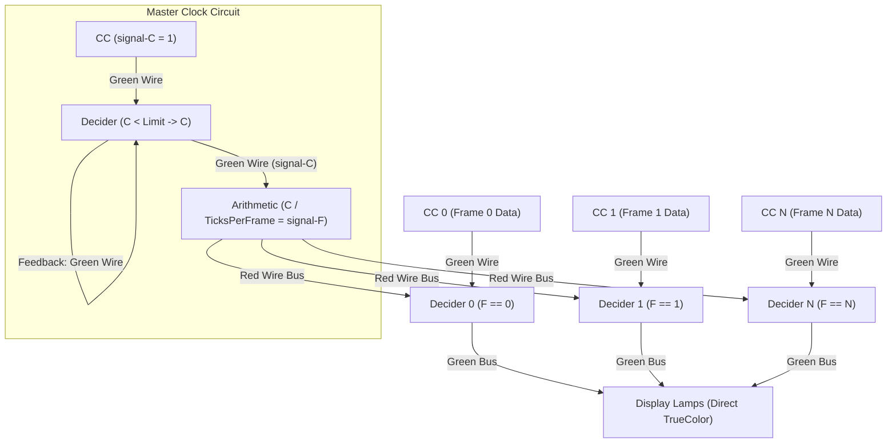
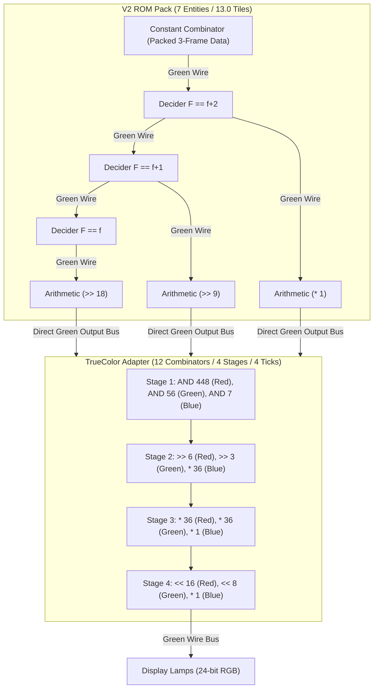
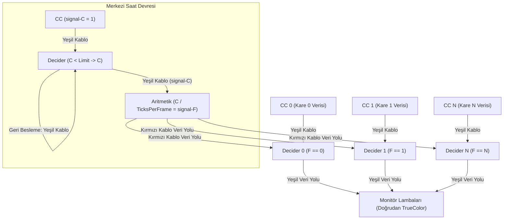
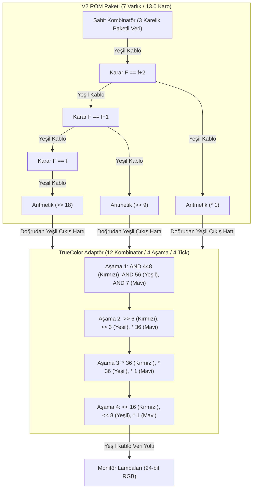

# Factorio 2.0 Color Circuit Engines (V1 TrueColor & V2 Compact Color) 🎨
## Full 24-bit TrueColor, 9-bit Packed RGB & 13,008-Signal Space Age Architecture

[**English**](#-english) | [**Türkçe**](#-türkçe)

---

# 🇬🇧 English

This document provides architectural specifications for the two color-enabled circuit synthesis engines: **Engine V1 (24-bit TrueColor)** and **Engine V2 (9-bit Compact RGB)**. Both engines utilize Factorio 2.0 Space Age quality tiers (`normal`, `uncommon`, `rare`, `epic`, `legendary`, `quality-unknown`) across 2,168 safe base signals, achieving **13,008 unique pixel channels per single bus stripe**.

---

## 1. Engine V1: Direct 24-bit TrueColor Architecture

Engine V1 is the zero-compromise engine for maximum color fidelity. Every frame is stored in its unquantized 24-bit RGB representation.

* **Master Clock:** Emits `signal-F` (Frame Index), counting periodically from `0` to `total_frames - 1`.
* **ROM Storage:** 1 Constant Combinator + 1 Decider Combinator per frame.
* **Color Depth:** 24-bit direct TrueColor packed integer:
  $$\text{PackedRGB} = (R \ll 16) \mid (G \ll 8) \mid B$$
* **Display Bus:** Green wire trunk lines carrying up to **13,008 unique signals** (2,168 items $\times$ 6 qualities).
* **Decoders:** 0 combinators needed (direct lamp readout).

---

## 2. Engine V2: 9-bit Compact Color Architecture

Engine V2 provides color video playback while achieving a 3x reduction in Constant Combinators by packing 3 frames into each 27-bit integer:

* **Pixel Encoding:** 9-bit RGB ($R_3 \ll 6 \mid G_3 \ll 3 \mid B_3$), where each channel has 8 intensity levels ($0..7$).
* **Packing:** 3 frames ($F_0, F_1, F_2$) packed into a 27-bit integer:
  $$\text{Value} = (\text{Pix}_0 \ll 18) \mid (\text{Pix}_1 \ll 9) \mid \text{Pix}_2$$
* **ROM Storage:** 1 Constant Combinator + 6 Combinators (3 Deciders + 3 Shifters = 7 entities total per 3-frame pack).
* **Unit Footprint:** Exactly **13.0 tiles** width (6 combinators $\times$ 2 tiles + 1 CC $\times$ 1 tile = 13.0 tiles), down from 15–19 tiles.
* **Elimination of Redundant `AND 511`:**
  - In earlier revisions, each ROM pack included an intermediate `Each AND 511` combinator after each shifter.
  - The TrueColor RGB adapter's input stage consists of three parallel combinators: `AND 448` ($111000000_2$ Red), `AND 56` ($000111000_2$ Green), and `AND 7` ($000000111_2$ Blue).
  - Since $448 + 56 + 7 = 511$ ($111111111_2$), the TrueColor adapter stage naturally masks all upper bits. Bypassing the intermediate `AND 511` is mathematically lossless and saves 3 combinators per pack.
* **Direct Shifter Wiring:** The output green pins of the shifter combinators (`>> 18`, `>> 9`, `* 1`) are tied together and wired directly to the green input bus of the TrueColor adapter stage (`AND 448`, `AND 56`, `AND 7`).
* **Pipeline Latency & Clock Synchronization:**
  - Removing `AND 511` reduces total pipeline latency from **7 ticks down to 6 ticks**:
    1. **Tick 1:** Decider Combinator (`signal-F == f`)
    2. **Tick 2:** Shifter Combinator (`>> 18`, `>> 9`, `* 1`)
    3. **Tick 3:** Adapter Stage 1 (`AND 448`, `AND 56`, `AND 7`)
    4. **Tick 4:** Adapter Stage 2 (`>> 6`, `>> 3`, `* 36`)
    5. **Tick 5:** Adapter Stage 3 (`* 36`, `* 36`, `* 1`)
    6. **Tick 6:** Adapter Stage 4 (`<< 16`, `<< 8`, `* 1`)
  - The master selector clock to display trigger offset is adjusted by 1 tick to preserve frame synchronization.
* **Stripe Capacity:** **13,008 pixels** using all 6 qualities.
* **Head Decoder:** 12 arithmetic combinators per stripe unpacking individual frame values into 24-bit TrueColor lamp outputs.

---

## 3. Circuit Engine Comparison

| Feature | Engine V1 (TrueColor) | Engine V2 (Compact Color) | Engine V3 (High-Capacity) |
| :--- | :--- | :--- | :--- |
| **Color Depth** | **24-bit TrueColor (16.7M colors)** | **9-bit RGB (512 colors)** | 2-bit Grayscale (4 levels) |
| **Frames per Signal**| 1 Frame / Signal | 3 Frames / Signal | **16 Frames / Signal** |
| **ROM Units** | 1 CC + 1 Decider / frame | **1 CC + 6 Combinators / 3 frames** | **1 CC + 1 Decider / 16 frames** |
| **Entities per Pack** | 2 entities | **7 entities** (13.0 tiles) | 2 entities (3.0 tiles) |
| **Pipeline Latency** | 1 tick | **6 ticks** | 4 ticks |
| **Stripe Capacity** | **13,008 pixels** (6 qualities) | **13,008 pixels** (6 qualities) | **13,008 pixels** (6 qualities) |
| **Decoder Units** | 0 combinators | 12 combinators / stripe | 4 combinators / stripe |
| **Primary Use Case** | Pristine color clips, logos, pixel art | Colored animations, clips | Long video playback, massive screens |

---
---

# 🇹🇷 Türkçe

Bu belge, renkli video oynatımı sağlayan iki devre motorunun teknik mimarisini açıklar: **Motor V1 (24-bit TrueColor)** ve **Motor V2 (9-bit Kompakt RGB)**. Her iki motor da Factorio 2.0 Space Age kalite seviyelerini (`normal`, `uncommon`, `rare`, `epic`, `legendary`, `quality-unknown`) 2.168 güvenli temel sinyalle birlikte kullanarak **tek bir yeşil kablo şeridinde 13.008 piksellik** kapasite sunar.

---

## 1. Motor V1: Doğrudan 24-bit TrueColor Mimarisi

Motor V1, sıfır renk kaybı ve doğrudan renk doğruluğu isteyen durumlar için tasarlanmıştır. Her kare, kuantize edilmeden 24-bit RGB formatında saklanır.

* **Merkezi Saat:** `signal-F` (Kare İndeksi), `0`'dan `total_frames - 1`'e kadar periyodik sayar.
* **ROM Depolama:** Kare başına 1 Sabit Kombinatör + 1 Karar Kombinatörü.
* **Renk Derinliği:** 24-bit doğrudan TrueColor paketli tamsayı:
  $$\text{PaketliRGB} = (R \ll 16) \mid (G \ll 8) \mid B$$
* **Veri Yolu (Display Bus):** 2.168 sinyal $\times$ 6 kalite sayesinde şerit başına **13.008 piksel** kapasite.
* **Dekoder İhtiyacı:** Sıfır (lambalar doğrudan veri yolundaki rengi okur).

---

## 2. Motor V2: 9-bit Kompakt Renkli Mimari

Motor V2, renkli oynatımı korurken 3 kareyi tek bir 27-bit tamsayı içine sıkıştırarak Sabit Kombinatör sayısını 3 kat azaltır:

* **Piksel Kodlama:** 9-bit RGB ($R_3 \ll 6 \mid G_3 \ll 3 \mid B_3$), her kanal 8 parlaklık seviyesine sahiptir ($0..7$).
* **Paketleme:** 3 ardışık kare ($F_0, F_1, F_2$) 27-bitlik tamsayıya paketlenir:
  $$\text{PaketliDeger} = (\text{Pix}_0 \ll 18) \mid (\text{Pix}_1 \ll 9) \mid \text{Pix}_2$$
* **ROM Depolama:** 3 karelik paket başına 1 Sabit Kombinatör + 6 Kombinatör (3 Karar + 3 Kaydırıcı; toplam 7 varlık).
* **Paket Genişliği:** Tam **13.0 karo** fiziksel genişlik (6 kombinatör $\times$ 2 karo + 1 CC $\times$ 1 karo = 13.0 karo; 15–19 karodan düşürüldü).
* **Gereksiz `AND 511` Kombinatörünün Kaldırılması:**
  - Önceki tasarımlarda her kaydırıcının çıkışında fazladan bir `Each AND 511` aritmetik kombinatörü yer alıyordu.
  - TrueColor RGB adaptörünün giriş basamağındaki üç paralel kombinatör: Kırmızı için `AND 448` ($111000000_2$), Yeşil için `AND 56` ($000111000_2$) ve Mavi için `AND 7` ($000000111_2$).
  - $448 + 56 + 7 = 511$ ($111111111_2$) ettiği için adaptör basamağı üst bitlerdeki tüm artıkları doğal olarak sıfırlar. Aradaki `AND 511` kombinatörü matematiksel olarak fazlalıktır ve tamamen kaldırılmıştır.
* **Doğrudan Kaydırıcı Kablolaması:** Kaydırıcı kombinatörlerin çıkış hattı (`>> 18`, `>> 9` ve `* 1` kombinatörlerinin çıkış pinleri), aradaki kombinatör atlanarak doğrudan TrueColor adaptörün giriş basamağına (`AND 448`, `AND 56` ve `AND 7` yeşil giriş pinlerine) bağlanır.
* **Gecikme ve Saat Senkronizasyonu:**
  - `AND 511` kaldırıldığı için devre hattı gecikmesi **7 tickten 6 ticke** düşürülmüştür:
    1. **Tick 1:** Karar Kombinatörü (`signal-F == f`)
    2. **Tick 2:** Kaydırıcı Kombinatör (`>> 18`, `>> 9`, `* 1`)
    3. **Tick 3:** Adaptör 1. Basamak (`AND 448`, `AND 56`, `AND 7`)
    4. **Tick 4:** Adaptör 2. Basamak (`>> 6`, `>> 3`, `* 36`)
    5. **Tick 5:** Adaptör 3. Basamak (`* 36`, `* 36`, `* 1`)
    6. **Tick 6:** Adaptör 4. Basamak (`<< 16`, `<< 8`, `* 1`)
  - Merkezi saat devresi ile monitör arasındaki tetikleme ofseti 1 tick öne çekilerek görüntü senkronizasyonu güncellenmiştir.
* **Şerit Kapasitesi:** 6 kalite seviyesi ile **13.008 piksel**.
* **Şerit Başı Dekoderi:** Şerit başına 12 aritmetik kombinatörü ile kare renkleri 24-bit TrueColor formatına çevrilerek lambalara iletilir.

---

## 3. Devre Motorları Karşılaştırması

| Özellik | Motor V1 (TrueColor) | Motor V2 (Kompakt Renkli) | Motor V3 (Yüksek Kapasiteli) |
| :--- | :--- | :--- | :--- |
| **Renk Derinliği** | **24-bit TrueColor (16.7M renk)** | **9-bit RGB (512 renk)** | 2-bit Gri Tonlama (4 seviye) |
| **Sinyal Başına Kare**| 1 Kare / Sinyal | 3 Kare / Sinyal | **16 Kare / Sinyal** |
| **ROM Birimi** | 1 CC + 1 Decider / kare | **1 CC + 6 Kombinatör / 3 kare** | **1 CC + 1 Decider / 16 kare** |
| **Paket Başına Varlık**| 2 varlık | **7 varlık** (13.0 karo) | 2 varlık (3.0 karo) |
| **Devre Gecikmesi** | 1 tick | **6 tick** | 4 tick |
| **Şerit Kapasitesi** | **13.008 piksel** (6 kalite) | **13.008 piksel** (6 kalite) | **13.008 piksel** (6 kalite) |
| **Dekoder Birimi** | 0 kombinatör | 12 kombinatör / şerit | 4 kombinatör / şerit |
| **İdeal Kullanım** | Canlı renkli klipler, logolar, piksel sanatı | Renkli animasyonlar, orta boy klipler | Uzun videolar, devasa ekranlar |
