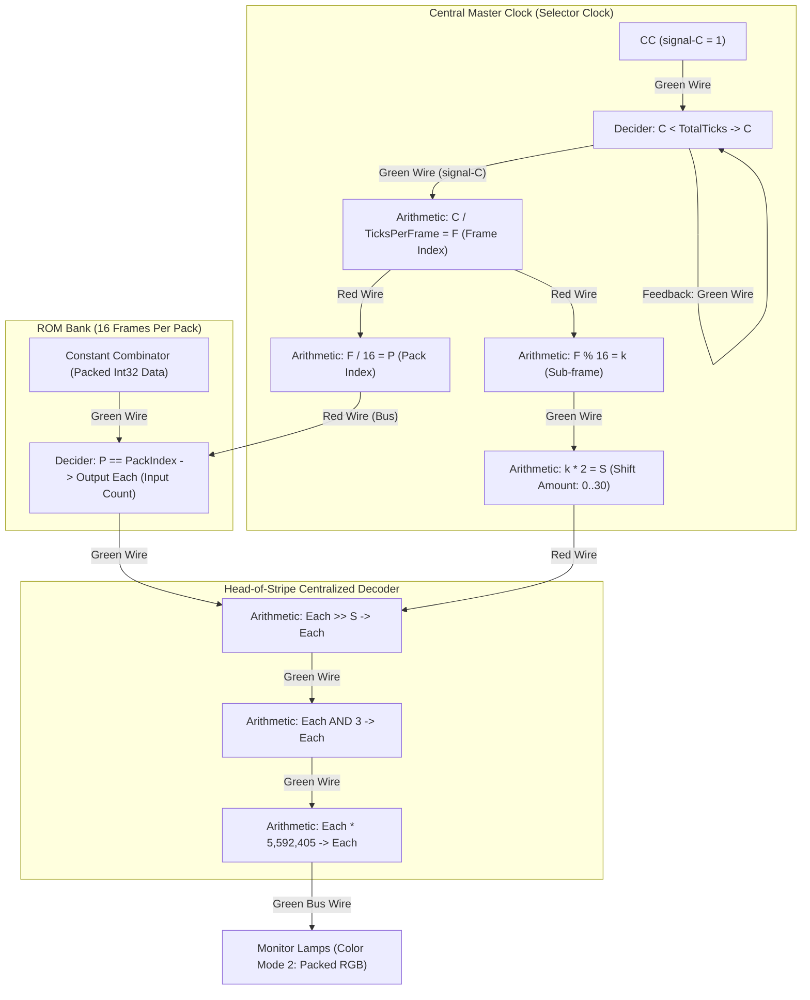
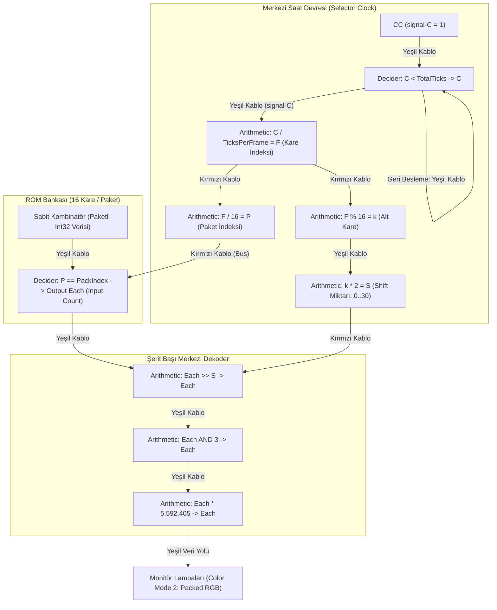

# Factorio 2.0 Circuit Engine V3 Architecture ⚡
## Dynamic Shift, 6 Qualities & Centralized Stripe Decoding

[**English**](#-english) | [**Türkçe**](#-türkçe)

---

# 🇬🇧 English

> **Audience:** This document serves as the complete engineering specification for **Circuit Engine V3 (`core/circuit_engine_v3.py`)**, covering mathematical foundations, bit-packing formulas, circuit schematics, and wiring constraints for developers and AI agents.

---

## 1. Overview & Architectural Revolution

### Why Circuit Engine V3?
* **Engine V1 (Classic RGB):** Uses an independent Constant Combinator (CC) and Decider Combinator (DC) for every single frame. Each signal carries a 24-bit RGB packed integer ($1 \text{ CC} = 1 \text{ Frame} \times 285 \text{ Pixels}$). Long videos produce tens of thousands of combinators.
* **Engine V2 (9-bit Packed RGB):** Compresses 3 pixels into one signal (27-bit packing), reducing mechanical combinator footprint but still requiring per-frame storage.
* **NEW Circuit Engine V3 (Temporal 2-Bit Packing + 6 Qualities):**
  1. **6 Factorio Qualities & 2,168 Extended Signal Pool:** By utilizing Space Age signals across **all 6 qualities** (`normal`, `uncommon`, `rare`, `epic`, `legendary`, `quality-unknown`), the capacity of a single green bus stripe is increased to **$2,168 \times 6 = \mathbf{13,008}$ pixels**! Standard resolutions like $32 \times 32$, $64 \times 64$, $80 \times 60$, and $100 \times 100$ run on a **SINGLE STRIPE** without splitting.
  2. **Centralized Head-of-Stripe Decoding:** Dynamic shift (`>> S`) and mask (`AND 3`) combinators are placed **once per stripe** in front of the TrueColor adapter (`* 5,592,405`), rather than inside every individual pack.
  3. **Ultra-Compact ROM:** Each 16-frame ROM pack consists of **ONLY 2 COMBINATORS** (1 Decider + 1 CC = 3 tiles width). Signal complexity is minimized, and ROM footprint is reduced by over 57%.

---

## 2. Mathematical Foundations & Bit Packing

### 2.1. 2-Bit Grayscale Quantization
RGB colors are converted to grayscale using the standard ITU-R BT.601 luma formula:

$$Y = \frac{299 \cdot R + 587 \cdot G + 114 \cdot B}{1000}$$

$$\text{Level2Bit} = \min\left(3, \max\left(0, \left\lfloor \frac{Y \cdot 3 + 127}{255} \right\rfloor \right)\right)$$

| Level (2-bit) | Representation | 8-Bit Grayscale | Hex Value | Color |
| :---: | :---: | :---: | :---: | :---: |
| `0` (`0b00`) | Black | `0` | `#000000` | Black |
| `1` (`0b01`) | Dark Gray | `85` | `#555555` | Dark Gray |
| `2` (`0b10`) | Light Gray | `170` | `#AAAAAA` | Light Gray |
| `3` (`0b11`) | White | `255` | `#FFFFFF` | White |

### 2.2. LSB-First 16-Frame Signal Packing (`pack_16frames_to_int32`)
A Factorio signal carries a 32-bit signed integer (`int32`, range: $[-2^{31}, 2^{31}-1]$).
Frames are packed sequentially starting from bit 0:

```text
Bit:    31 30 | 29 28 | ... |  5  4  |  3  2  |  1  0
Frame:  k=15  | k=14  | ... |  k=2   |  k=1   |  k=0
Shift:   30   |  28   | ... |   4    |   2    |   0
```

$$\text{Shift}(k) = 2 \times k \quad (k \in [0, 15] \rightarrow 0, 2, 4, \dots, 30)$$
$$\text{Value} = \sum_{k=0}^{15} \left( (v_k \operatorname{AND} 3) \times 2^{2k} \right)$$
*(Bitwise logic: `Value = (v_0 & 3) | ((v_1 & 3) << 2) | ... | ((v_15 & 3) << 30)`)*

When bit 31 is set, Python converts the value to a signed 32-bit integer compatible with Factorio:
```python
if val >= 0x80000000:
    val -= 0x100000000
```

---

## 3. Circuit Pipeline Architecture



### 3.1. Single-Combinator TrueColor Multiplier (`* 5,592,405`)
To convert a 2-bit level ($0, 1, 2, 3$) into 24-bit TrueColor packed RGB $(R \ll 16) | (G \ll 8) | B$:
$$\text{Multiplier} = 256^2 \times 85 + 256 \times 85 + 85 = 5,592,405$$
* Level `0` $\times 5,592,405 = \mathbf{0}$ (`#000000` Black)
* Level `1` $\times 5,592,405 = \mathbf{5,592,405}$ (`#555555` Dark Gray)
* Level `2` $\times 5,592,405 = \mathbf{11,184,810}$ (`#AAAAAA` Light Gray)
* Level `3` $\times 5,592,405 = \mathbf{16,777,215}$ (`#FFFFFF` White)

---
---

# 🇹🇷 Türkçe

> **Hedef Kitle:** Bu belge, **Circuit Engine V3 (`core/circuit_engine_v3.py`)** mimarisini, matematiksel temellerini, devre şemasını ve kablolama kurallarını geliştiriciler için eksiksiz olarak açıklar.

---

## 1. Genel Bakış ve Yeni V3 Mimarisi

### Neden Circuit Engine V3?
* **Engine V1 (Klasik RGB):** Her kare için bağımsız bir Sabit Kombinatör (CC) ve Karar Kombinatörü (DC) kullanır ($1 \text{ CC} = 1 \text{ Kare} \times 285 \text{ Piksel}$). Uzun videolarda on binlerce kombinatör gerekir.
* **Engine V2 (9-Bit Paketleme):** 3 pikseli tek sinyale sıkıştırır (27-bit paketleme), kombinatör sayısını mekanik olarak azaltır ancak yine de her 3 kare için ayrık bloklar gerektirir.
* **YENİ Circuit Engine V3 (Zamansal 2-Bit Paketleme + 6 Kalite):**
  1. **6 Kalite Seviyesi & 2.168 Genişletilmiş Sinyal Havuzu:** Space Age sinyalleri ve `normal`, `uncommon`, `rare`, `epic`, `legendary`, `quality-unknown` kaliteleriyle tek bir şeridin kapasitesi **$2.168 \times 6 = \mathbf{13.008}$ piksele** çıkarılmıştır! $32 \times 32$, $64 \times 64$, $80 \times 60$ ve $100 \times 100$ monitörler bölünmeye gerek kalmadan **TEK ŞERİTTE** çalışır.
  2. **Şerit Başı Merkezi Dekoder:** Shift (`>> S`) ve Maske (`AND 3`) kombinatörleri her pakete ayrı ayrı konulmak yerine şerit başına **yalnızca 1 kez** adaptörün (`* 5.592.405`) önüne yerleştirilir.
  3. **Ultra Kompakt ROM:** 16 karelik paket ROM içinde **SADECE 2 KOMBİNATÖRDEN** (1 Decider + 1 CC = 3 karo genişlik) oluşur. Sinyal ve kablo kalabalığı en aza inmiş, ROM genişliği %57 küçülmüştür.

---

## 2. Matematiksel Temeller ve Bit Paketleme

### 2.1. 2-Bit Gri Tonlama (Grayscale Quantization)
RGB renkleri ITU-R BT.601 luma formülü ile gri tonlamaya dönüştürülür ve 4 basamağa ayrıştırılır:

$$Y = \frac{299 \cdot R + 587 \cdot G + 114 \cdot B}{1000}$$

$$\text{Level2Bit} = \min\left(3, \max\left(0, \left\lfloor \frac{Y \cdot 3 + 127}{255} \right\rfloor \right)\right)$$

| Seviye (2-bit) | Temsil | 8-Bit Karşılığı | Hex Değeri | Renk |
| :---: | :---: | :---: | :---: | :---: |
| `0` (`0b00`) | Siyah | `0` | `#000000` | Siyah |
| `1` (`0b01`) | Koyu Gri | `85` | `#555555` | Koyu Gri |
| `2` (`0b10`) | Açık Gri | `170` | `#AAAAAA` | Açık Gri |
| `3` (`0b11`) | Beyaz | `255` | `#FFFFFF` | Beyaz |

### 2.2. En Alt Bitten 16 Karelik Sinyal Paketleme (`pack_16frames_to_int32`)
Bir Factorio sinyali 32-bit işaretli tamsayıdır (`int32`, aralık: $[-2^{31}, 2^{31}-1]$).
Dinamik shift miktarı $S = 2 \times k$ olduğundan, kareler doğrudan **bit 0'dan başlayarak** paketlenir:

```text
Bit:    31 30 | 29 28 | ... |  5  4  |  3  2  |  1  0
Kare:   k=15  | k=14  | ... |  k=2   |  k=1   |  k=0
Shift:   30   |  28   | ... |   4    |   2    |   0
```

$$\text{Shift}(k) = 2 \times k \quad (k \in [0, 15] \rightarrow 0, 2, 4, \dots, 30)$$
$$\text{Değer} = \sum_{k=0}^{15} \left( (v_k \operatorname{AND} 3) \times 2^{2k} \right)$$
*(Bitsel mantık: `Değer = (v_0 & 3) | ((v_1 & 3) << 2) | ... | ((v_15 & 3) << 30)`)*

Bit 31 set edildiğinde değer Factorio tarafından negatif 32-bit tamsayı olarak yorumlanır:
```python
if val >= 0x80000000:
    val -= 0x100000000
```

---

## 3. Devre Hattı Mimarisi



### 3.1. Tek Kombinatörlük TrueColor Çarpanı (`* 5.592.405`)
2-bit seviyeyi ($0, 1, 2, 3$) 24-bit TrueColor RGB değerine dönüştürmek için:
$$\text{Çarpan} = 256^2 \times 85 + 256 \times 85 + 85 = 5.592.405$$
* Seviye `0` $\times 5.592.405 = \mathbf{0}$ (`#000000` Siyah)
* Seviye `1` $\times 5.592.405 = \mathbf{5.592.405}$ (`#555555` Koyu Gri)
* Seviye `2` $\times 5.592.405 = \mathbf{11.184.810}$ (`#AAAAAA` Açık Gri)
* Seviye `3` $\times 5.592.405 = \mathbf{16.777.215}$ (`#FFFFFF` Beyaz)
