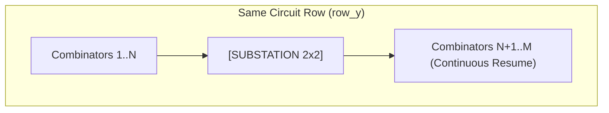
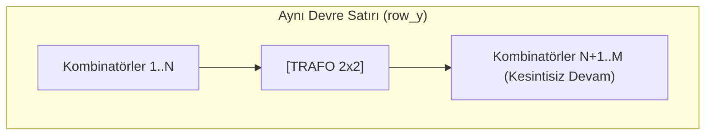

# Factorio 2.0 Compact ROM Architecture 📐
## Per-Combinator Continuous Clearance, Collision Avoidance & Pitch Optimization

[**English**](#-english) | [**Türkçe**](#-türkçe)

---

# 🇬🇧 English

This document details the **Compact ROM Architecture** within the Factorio 2.0 circuit synthesis engine, explaining substation collision handling, wiring reach constraints, pitch optimization, and architectural distinctions between engine versions.

---

## 1. Physical Constraints in Display Memory

When constructing large-scale animated displays in Factorio, two physical constraints govern circuit placement:
1. **Factory Footprint:** Conventional layouts place safety margins (2–4 tiles) between the display, decoders, and ROM banks. Multiplying these gaps across thousands of combinators dramatically inflates total factory footprint.
2. **Substation Grids & Obstacles:** Substations (2x2 footprint with 18x18 to 28x28 supply reach) must be embedded directly inside ROM rows to power the circuitry. Fixed placement can collide with combinators and exceed Factorio's maximum circuit wire reach (**9.0 tiles**).

**Compact ROM Mode** snaps combinator arrays directly against monitors and decoders with zero unnecessary padding, dynamically flowing around substations with 100% space efficiency.

---

## 2. Per-Combinator Continuous Collision Clearance

Rather than skipping entire memory rows or crudely shifting entire memory banks when colliding with a substation, our layout engine performs **micro-level continuous collision clearance**:

1. **Row Assignment:** Each frame packet $u$ in a stripe is mapped to a target row `row_y` with vertical center $y_{\text{pos}} = \text{row}_y + 0.5$.
2. **Substation Query:** All substations overlapping the current row are queried:
   $$\text{RowSubs} = \{ \text{sub} \mid \text{sub.ty} \le y_{\text{pos}} < \text{sub.ty} + 2.0 \}$$
3. **Interval Intersection Rule:**
   Let the combinator occupy the 1D horizontal interval $[x, x + w)$, where $w$ is its physical width ($1.0$ for Constant Combinators, $2.0$ for Decider/Arithmetic Combinators).
   Let the substation occupy the interval $[st, en) = [tx, tx + 2.0)$, where $tx$ is the substation's left coordinate.
   
   A collision occurs if and only if the two intervals overlap:
   $$[x, x + w) \cap [st, en) \neq \emptyset \iff (x < en) \land (x + w > st)$$
   
   This handles both critical cases:
   - **Internal Start:** The combinator begins inside the substation ($x \ge st$ and $x < en$).
   - **Right-Edge Overflow:** The combinator begins to the left of the substation ($x < st$), but its right boundary overflows into the substation footprint ($x + w > st$).
   
   Whenever this intersection condition evaluates to true, the combinator's position immediately advances past the obstacle:
   $$x \leftarrow en$$
   This test repeats in a loop until no obstacles intersect $[x, x + w)$.

4. **Result:** Substations are seamlessly integrated between combinator cells. No memory lines are wasted, wire lengths remain well within the 9-tile limit, and ROM arrays bend organically around infrastructure.

---

## 3. Zero-Gap Pitch Optimization

* **Standard Mode (`compact_rom = false`):**
  - Decoder-to-ROM gap: +2.0 tiles.
  - Unit pitch: 20.0 tiles (includes 1-tile safety margin).
* **Compact Mode (`compact_rom = true`):**
  - Decoder-to-ROM gap: 0.0 tiles (directly snapped).
  - Unit pitch: Exact physical footprint of combinator entities (e.g. 13.0 tiles in V2 down from 19.0 tiles, 3.0 tiles in V3 per pack).
  - Internal buffer padding is completely eliminated.

---
---

# 🇹🇷 Türkçe

Bu doküman, Factorio 2.0 devre motorundaki **Kompakt ROM Mimarisi**'nin çalışma mantığını, trafo (substation) çarpışma yönetimini, kablolama kurallarını ve V1/V2/V3 motorları arasındaki optimizasyon farklarını detaylandırmaktadır.

---

## 1. Ekran Belleğinde Fiziksel Kısıtlar

Factorio'da büyük boyutlu video ekranları inşa edilirken iki kritik fiziksel kısıt bulunur:
1. **Harita Alanı (Footprint):** Standart yerleşimde modüller arasında 2-4 karo güvenlik boşlukları bırakıldığında fabrika alanı devasa boyutlara ulaşır.
2. **Elektrik Dağıtımı ve Trafolar:** 2x2 boyutundaki trafolar devre elemanlarının tam üstüne denk geldiğinde kombinatörlerin yerleşimini bozar ve kablo bağlantı mesafelerini (maksimum kablo sınırı: **9.0 karo**) zorlar.

**Kompakt ROM Modu**, monitöre ve dekoderlere sıfır boşlukla yapışan, trafoların etrafından dinamik olarak kayarak akan ve alanı %100 verimle kullanan bir yerleşim sunar.

---

## 2. Kombinatör Düzeyinde Sürekli Çarpışma Yönetimi

Trafolarla karşılaşıldığında tüm satır atlanmaz veya kaba blok kaydırması yapılmaz; kaydırma işlemi kombinatör bazında mikro düzeyde gerçekleştirilir:

1. **Satır Belirleme:** Şeritteki her kare paketi $u$ için satır `row_y` ve $y_{\text{pos}} = \text{row}_y + 0.5$ belirlenir.
2. **Trafo Taraması:** O satırın üzerinden geçen tüm trafolar filtrelenir:
   $$\text{RowSubs} = \{ \text{sub} \mid \text{sub.ty} \le y_{\text{pos}} < \text{sub.ty} + 2.0 \}$$
3. **Aralık Kesişim Kuralı:**
   Kombinatörün yatay düzlemdeki aralığı $[x, x + w)$ olsun ($w$: Sabit Kombinatör için $1.0$, Karar/Aritmetik için $2.0$ karo).
   Trafonun yatay düzlemdeki aralığı $[st, en) = [tx, tx + 2.0)$ olsun.
   
   İki geometrik aralığın kesişmesi için gerekli ve yeterli koşul:
   $$[x, x + w) \cap [st, en) \neq \emptyset \iff (x < en) \land (x + w > st)$$
   
   Bu kural her iki senaryoyu da eksiksiz kapsar:
   - **İçte Başlama:** Kombinatör başlangıç noktasının trafo alanı içinde kalması ($x \ge st$ ve $x < en$).
   - **Sağ Uç Taşması:** Kombinatör başlangıç noktasının trafo solunda kalıp sağ ucunun trafo ayak izine taşması ($x < st$ ve $x + w > st$).
   
   Bu kesişim koşulu sağlandığı anda kombinatörün konumu anında trafo alanının dışına ötelenir:
   $$x \leftarrow en$$
   Bu kontrol, $[x, x + w)$ aralığı hiçbir engelle çakışmayana kadar döngü içinde yinelenir.

4. **Sonuç:** Trafolar kombinatörlerin arasına kusursuzca gömülür. Hiçbir satır boş bırakılmaz, kablo mesafeleri 9.0 karo sınırının altında kalır ve ROM modülü trafonun etrafından doğal bir şekilde esneyerek devam eder.

---

## 3. Sıfır Boşluklu Adım (Pitch) Optimizasyonu

* **Standart Mod (`compact_rom = false`):**
  - Dekoder ile ROM arasında: +2.0 karo boşluk.
  - Birim adımı (unit pitch): 20.0 karo (1.0 karo güvenlik payı içerir).
* **Kompakt Mod (`compact_rom = true`):**
  - Dekoder ile ROM arasında: 0.0 karo (tam yapışık).
  - Birim adımı (unit pitch): Kombinatörlerin net fiziksel genişliği (V2 için 19.0 karodan düşürülerek 13.0 karo, V3 için paket başına 3.0 karo).
  - Modüller arasındaki tüm tampon boşluklar sıfırlanır.
